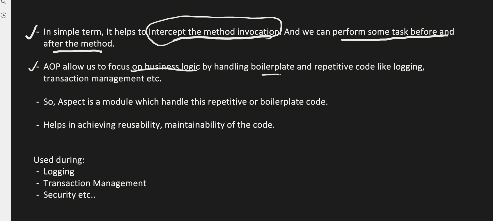
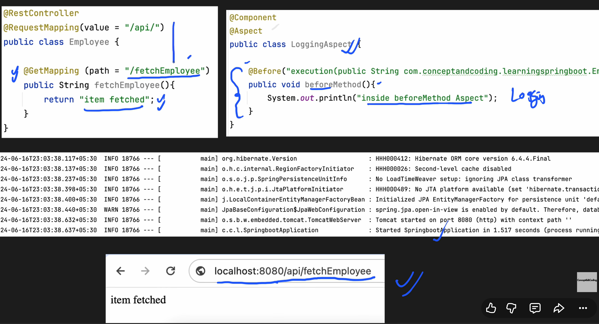
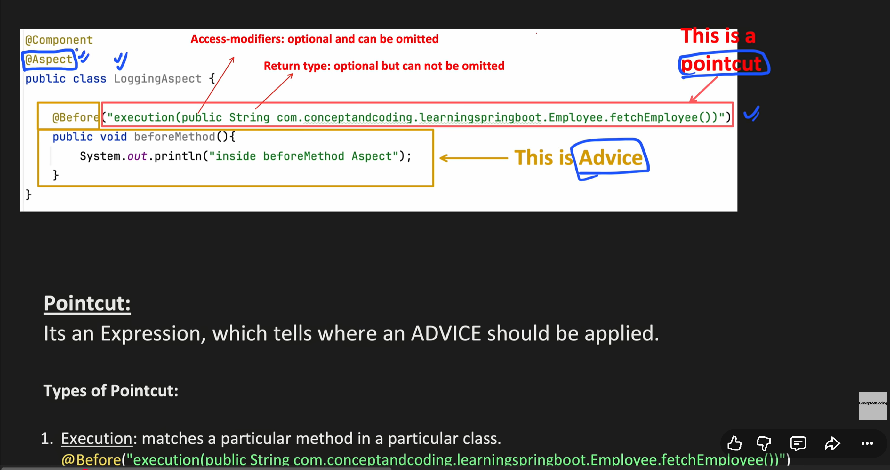
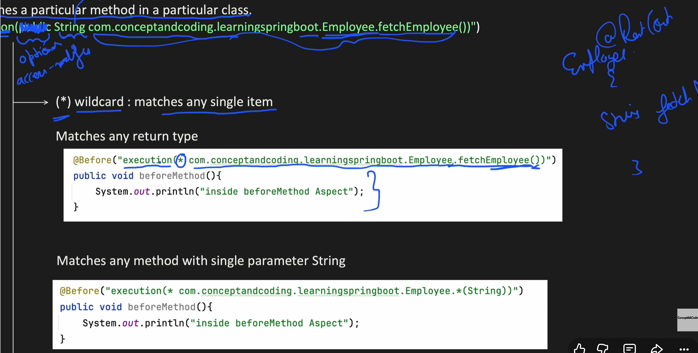
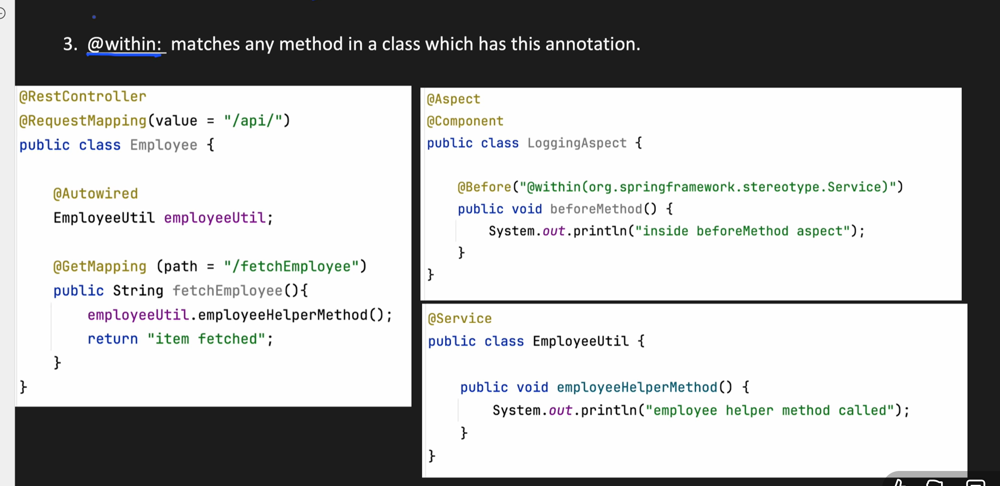
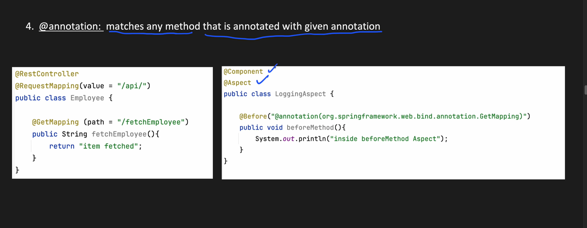
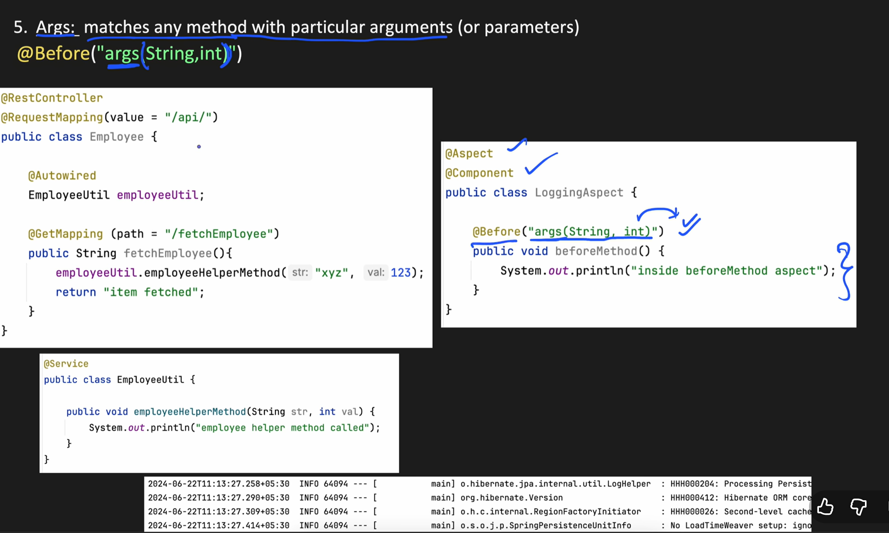
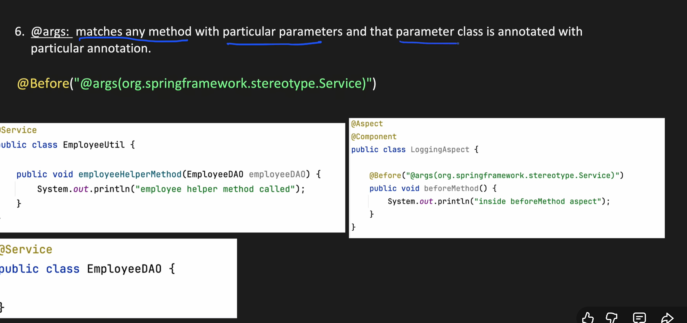
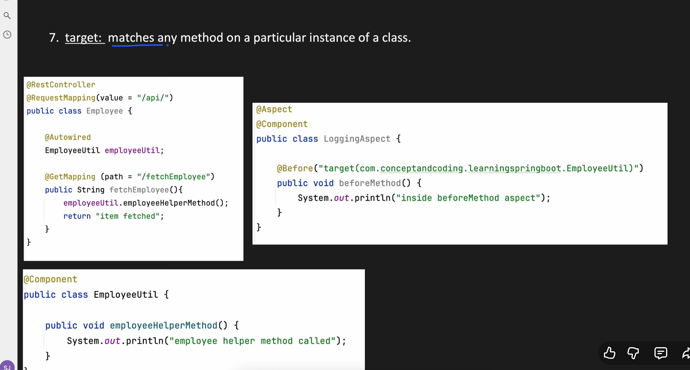

What is AOP?

There are some repetitve code that we need to write in each class/function like:
- logging
- open tranx , close tranx etc
All these are handeled by AOP
- Supports reusability and maintainability

