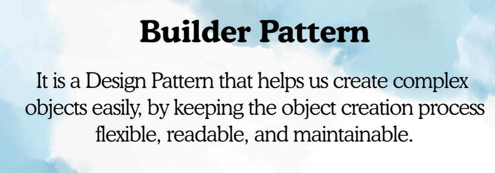

- Instead of passing multiple parameter in a huge constructor, build the constructor piece by piece

- User class has name age and email
- constructor initializez all the fields
- 
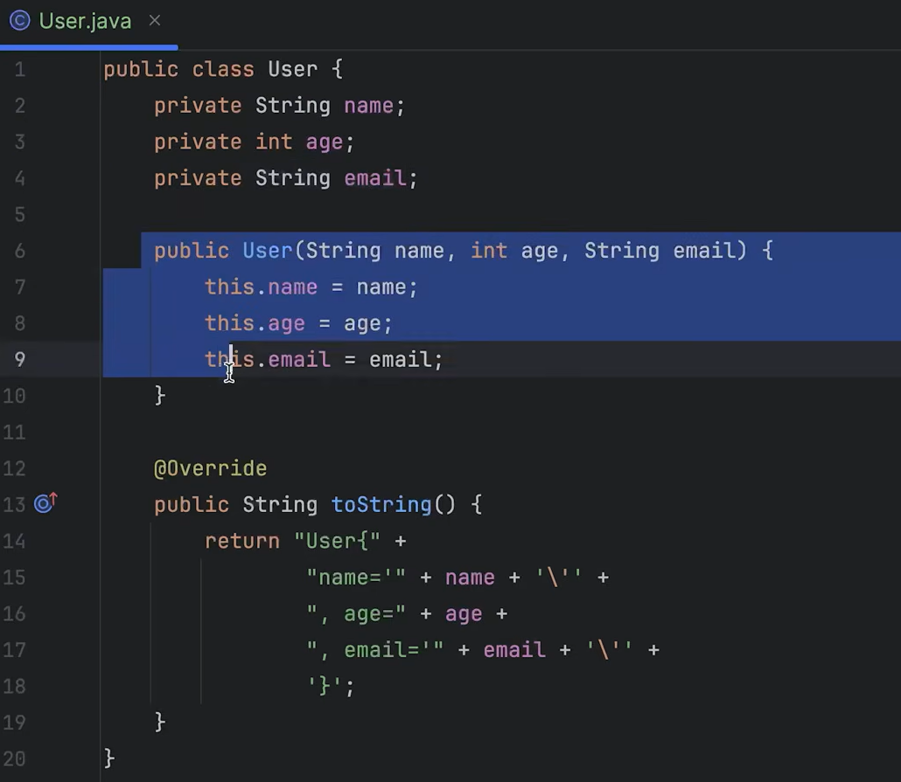

- Email, login and usermigrastion service are three class that create an object od User 

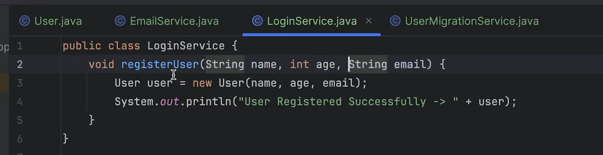

- new requirement comes where for login service need to send city also to register 
user 
- So I need to add the city field in both User class and its constructor
- but this change will throw error as email and migration service still use the old constructor
- to make this class backward compatible we need bulder pattern.

**Builder Pattern**
- Keep the actual class with only one constructor that has all the fields.
- Create separate buider class
- Copy all the fields from DTO class and create setters.
- instead of void make the return type as UserBuilder same as the class itself and return this.
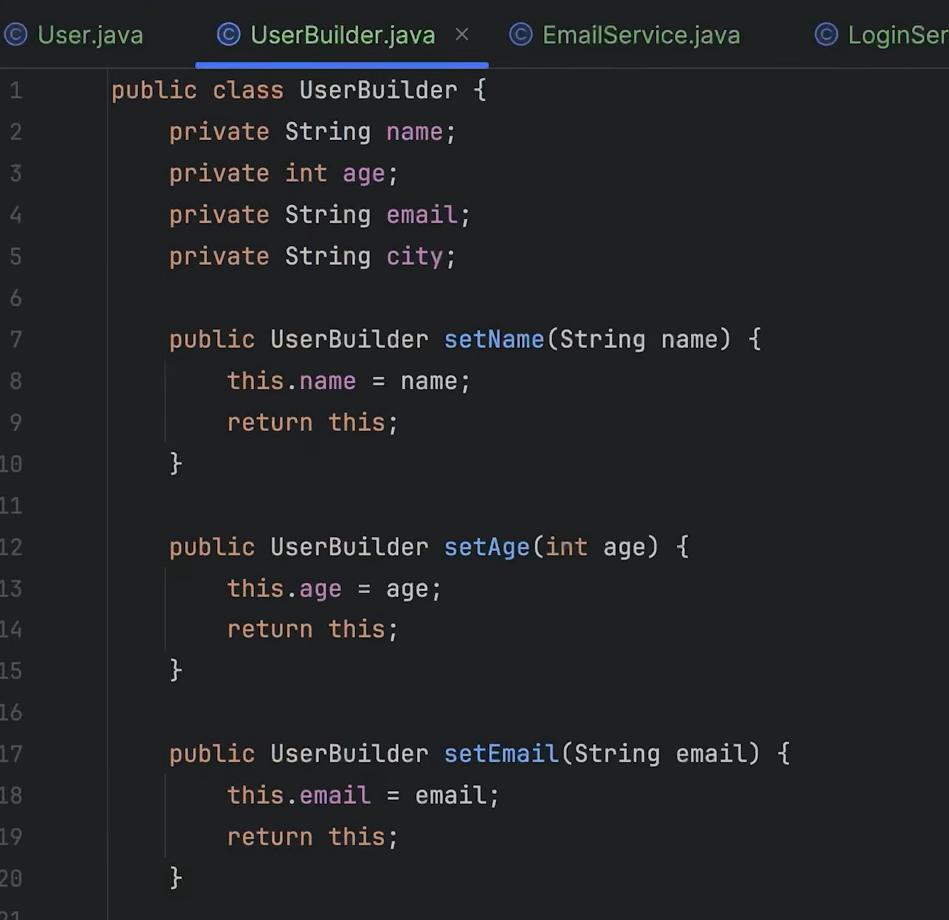

- Instantiate the UserBuilder and set values in client class
- 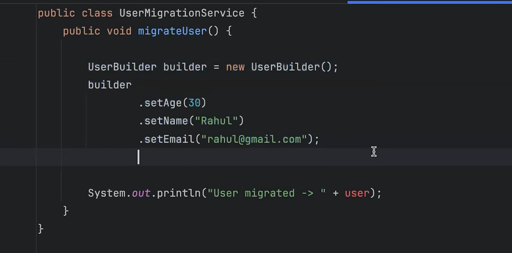
- pass the UserBuilder object as parameter in the User class constructor
- user builder has all the field values so create User object using values from UserBuilder object
- 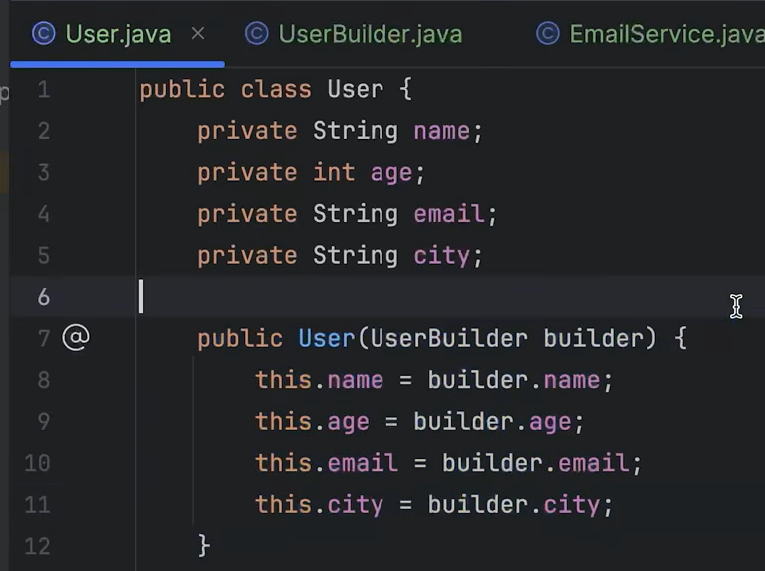
- Call the user constructor in the client class
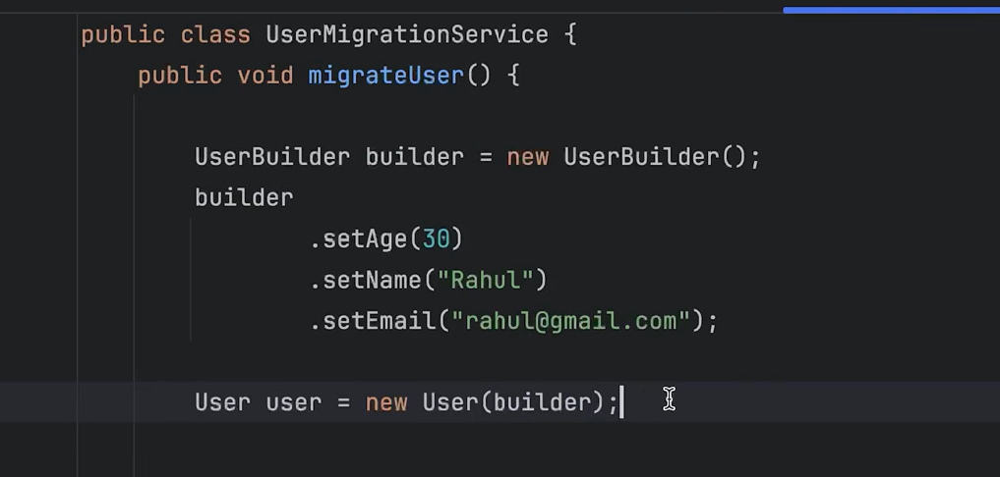
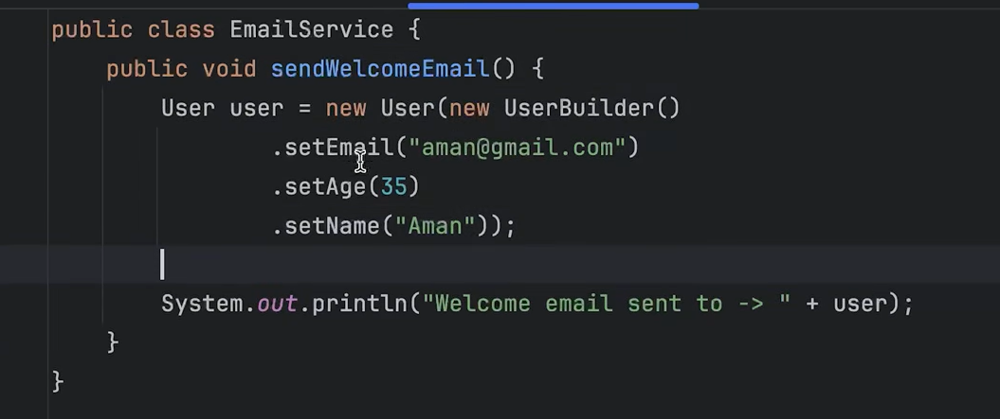

**Improvement**
 - Add the UserBuilder class inside the User class itself and make the User constructor private so that it cannot be accessed 
by client classes from outside
 - 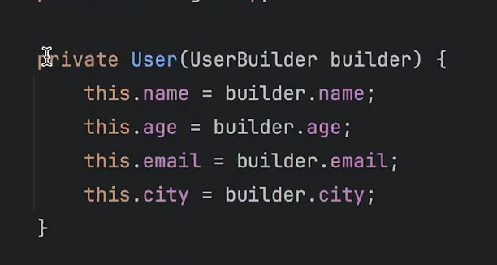
 - UserBuilder is public so provide method build which the clients can call to build specific objects with only required fields.
 - 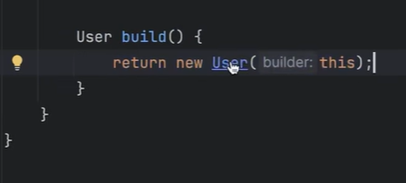
 - changes in client
 - 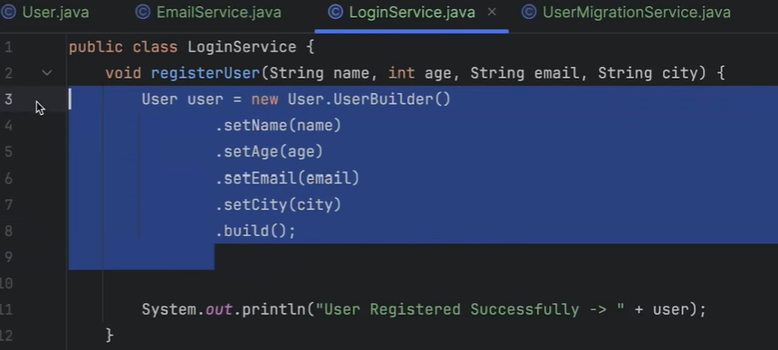
 - 

