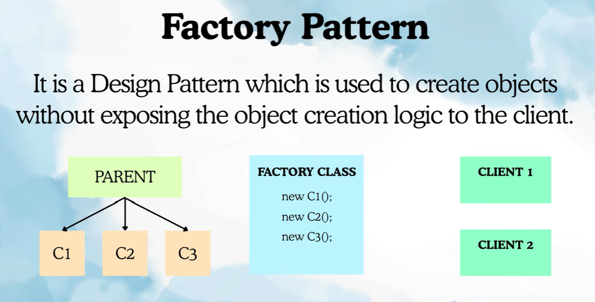
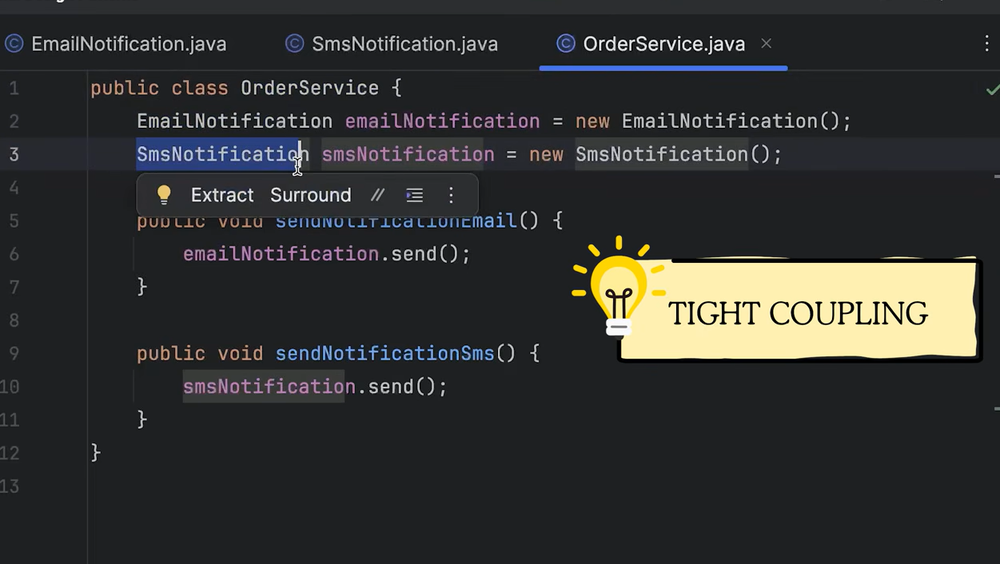
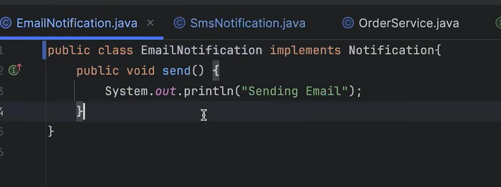
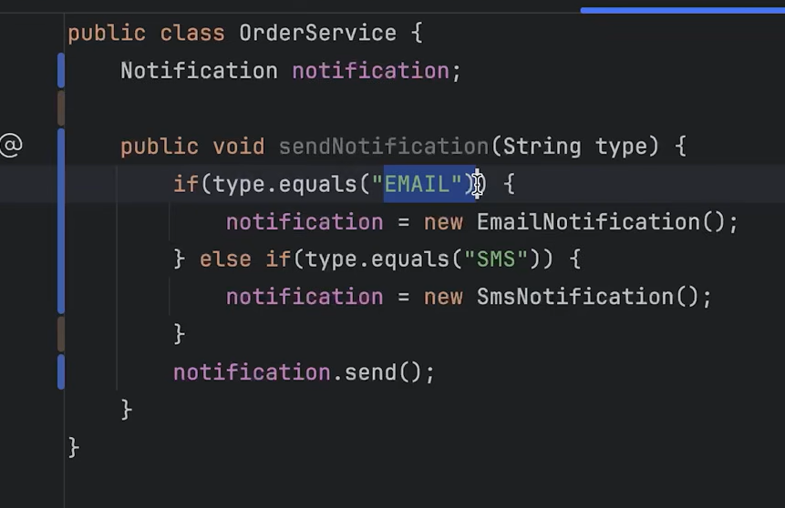
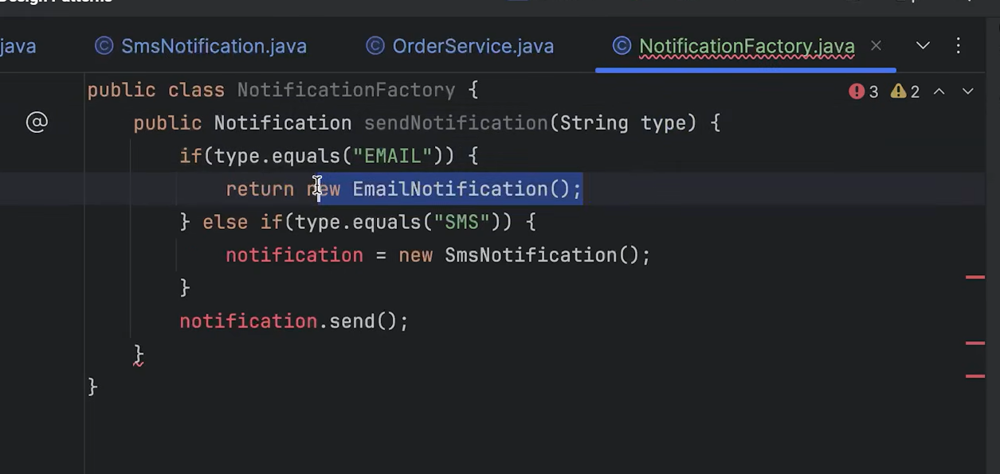
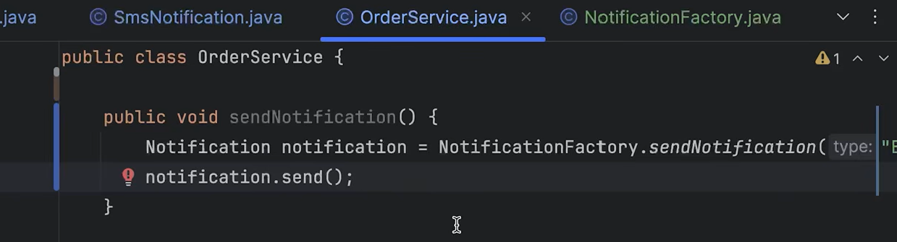
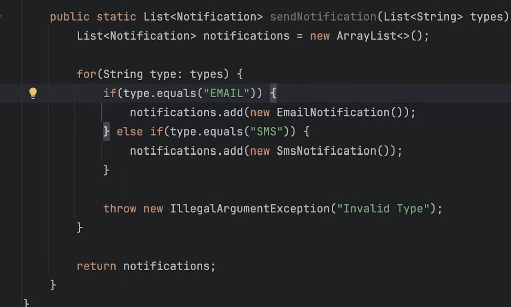
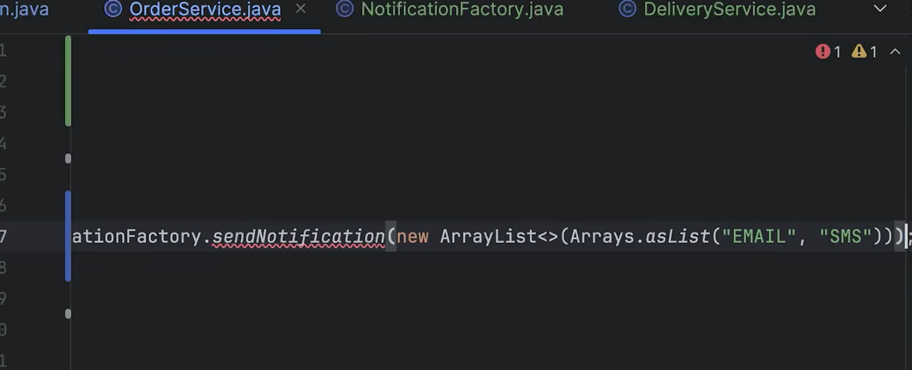

Definition

- We have a interface that multiple classes are implementing
- Client should not be creating the object instead we introduce a factory class that will
define the object creation logic for these clients
- Ex Food delivery app and there is a notification flow with two classes sma and email
- After Order is placed sms and email is sent from Order service itself
- 
- problem is code is tightly coupled and adding new functionality will create change in the existing code
- Create interface Notification and make both the classes(Email and SMS) implement this interface
- 
- New implementatiom
- 
- still object creation logic shouls not be there in the client class
- if some other class is sending notification then tne same logic need to be written agian leading to code duplicacy
- Create notificationFactory

- changes in client, Order service will directly use NotificationFactory which will give the object
- 

- Incase client wants both the notification email and sms
- add a method that accepts a list of notification types and returns object based on each type
- 

