- used when object creation is heavy task.
- prototype allows us to create the object once and simply clone it when required instead of 
creating the object again and again.
- improves performance and saves time.

Ways to implement in Java:

**Copy Constructor:**
- create new object by copying data of existing object

example: In games we have bot payers, trees and cars that look alike.

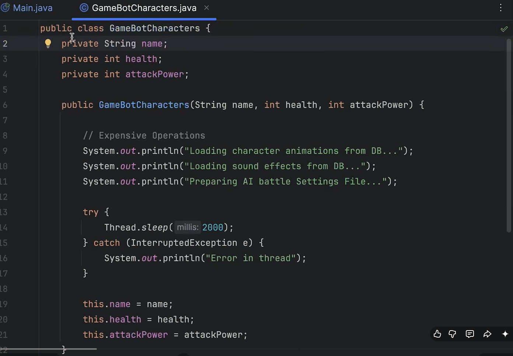

- In the main class we have created 5 objects
- upon execution total execution time is > 10 s
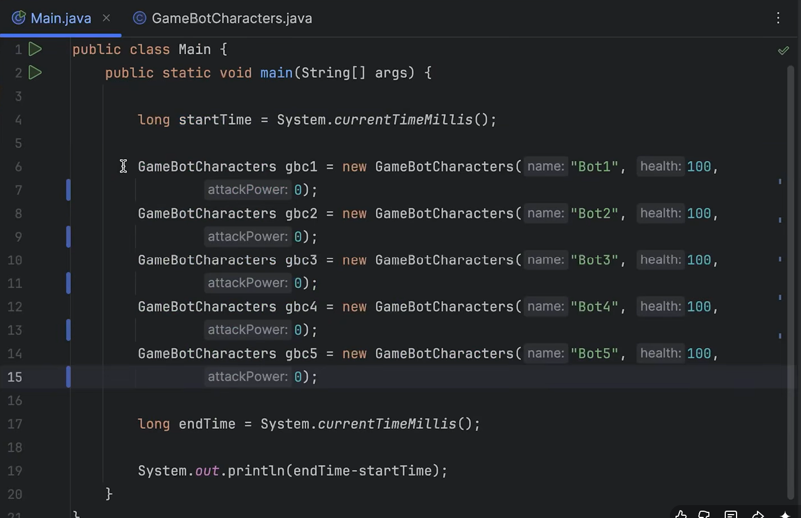

To reduce this time we implement the prototype pattern:
- Create copy constructor, make it private to not be able to call from outside
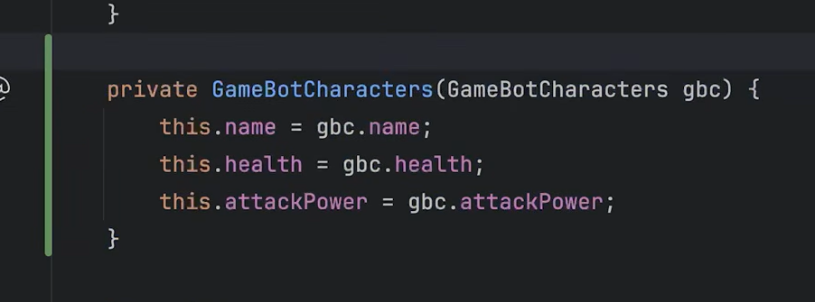

- Create a clonnable interface
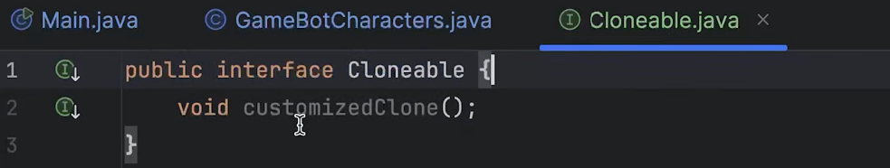

make gamebot class implement this interface and implement the customizedClone() method
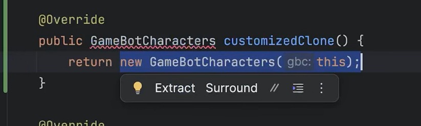

- this refers to the current object ( object that is calling the customizedClone() method)
- gbc1 is the new object created
- gbc2 calls the clone method and passed the the gbc1 obj
- this refers to gbc1 in the constructor and returns a copy of this object.
- point to be noted is that the heavy constructor containing characters and animations was never called.

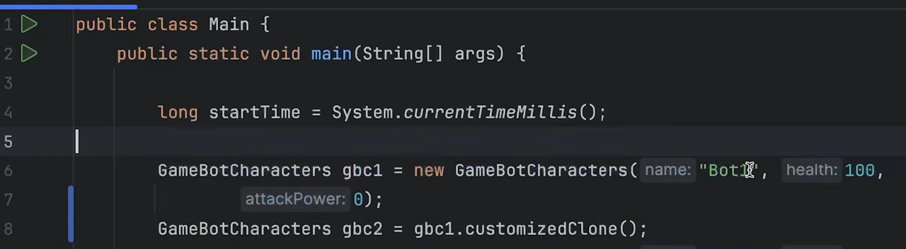

- Clone and print all the objects:
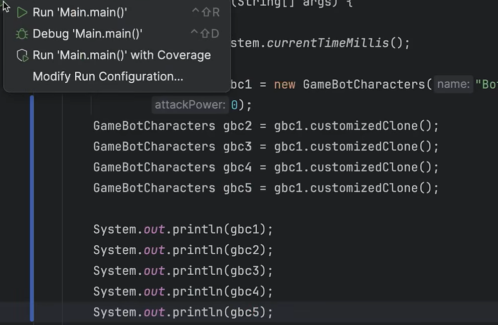

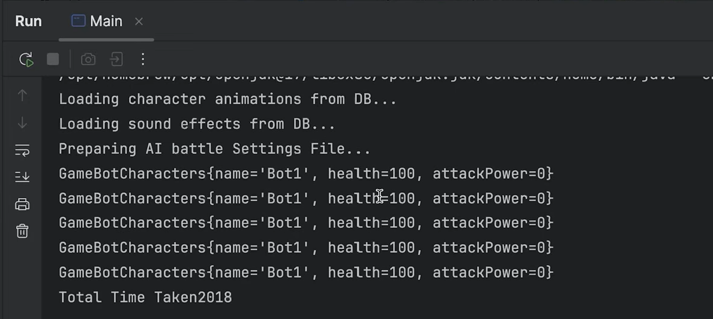

- All the characters are bot1

**How to allow/change different values of fields in prototype pattern**

- add setter methods in the class
- 
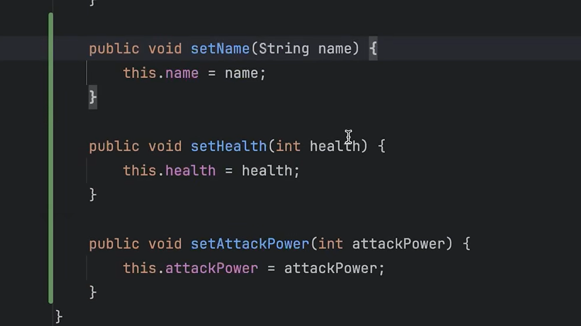
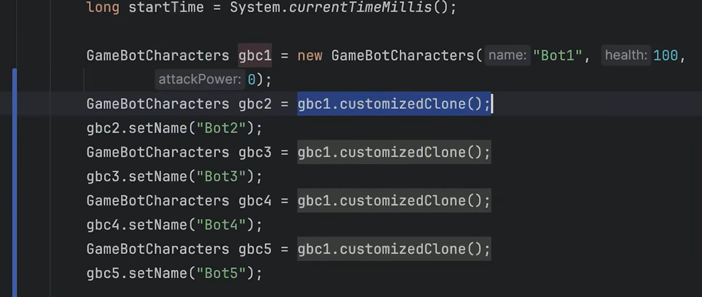

**Shallow copy vs Deep copy**
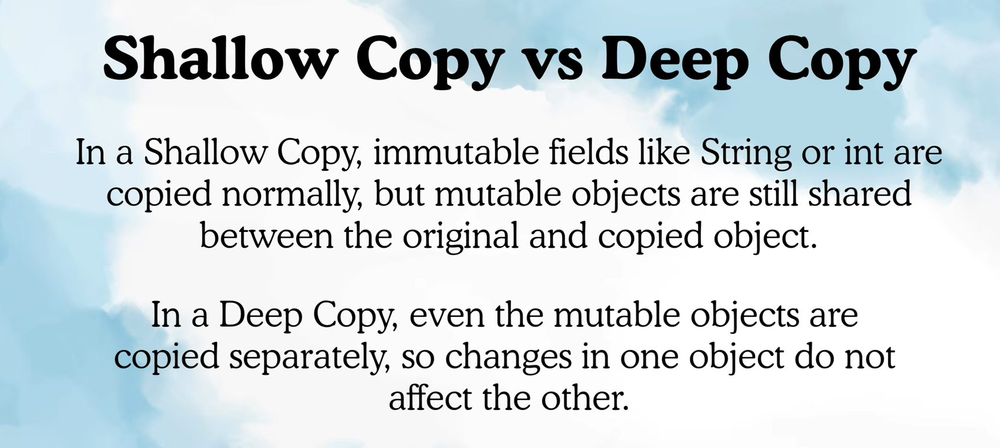

- what we implemented is shallow copy dealing with primitive types
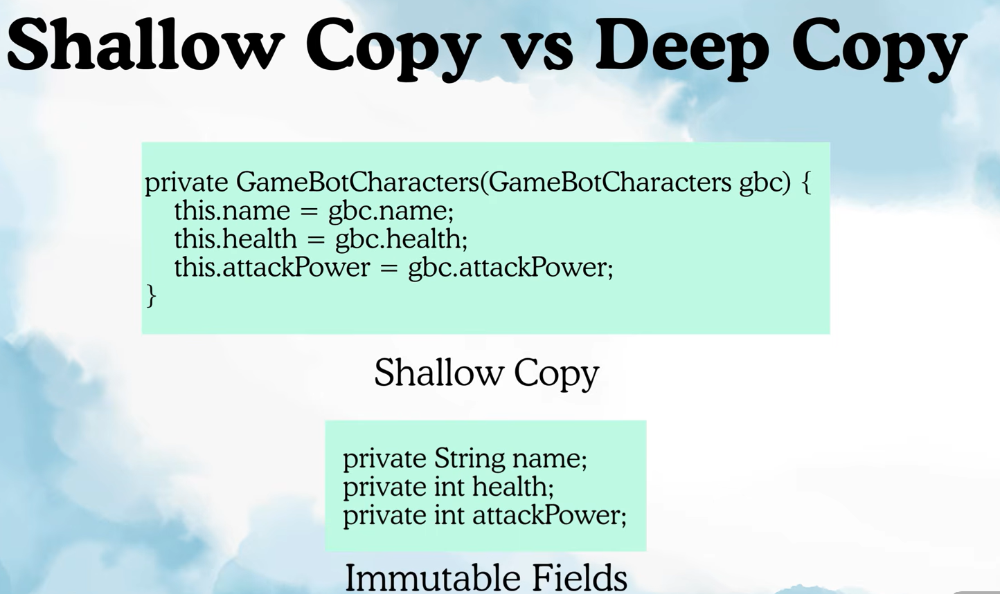
- problem arises with mutable fields - List or reference of another class.

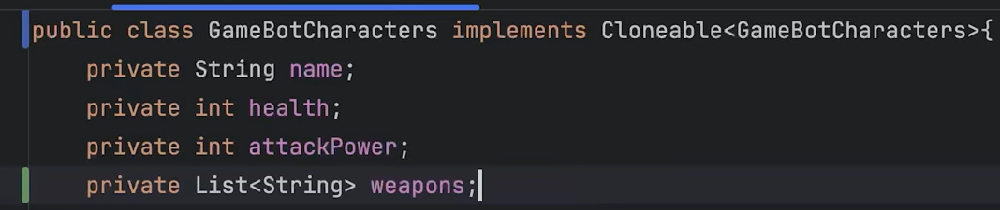

added sniper in bot5 weapon adds it everywhere.
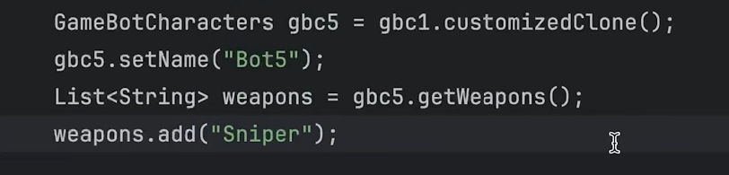
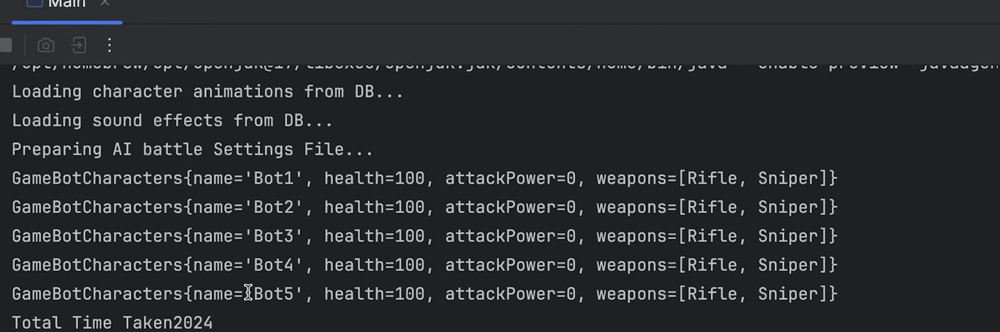

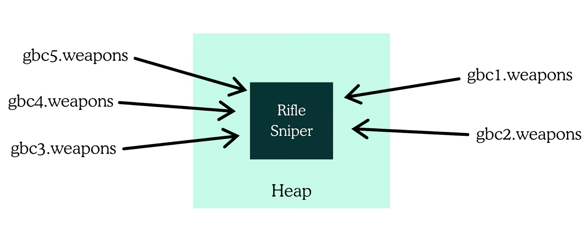

- Deep copy implementation
- everytime a clone is created a new memory localtion is allocated although the value is same as the original object

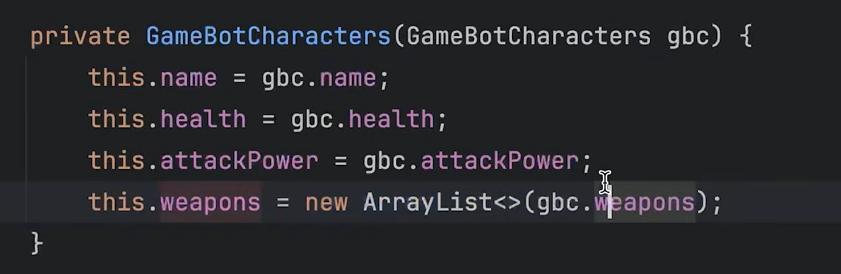

