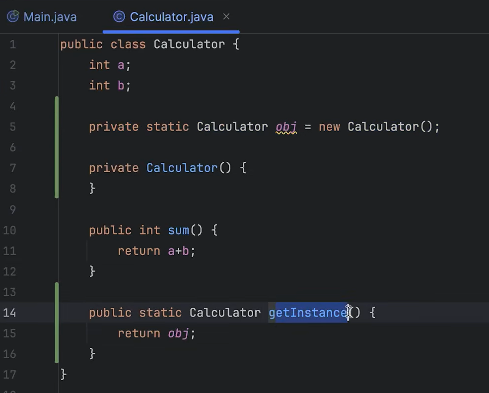
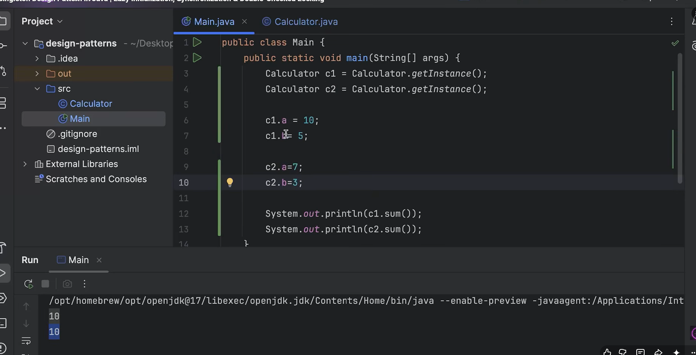
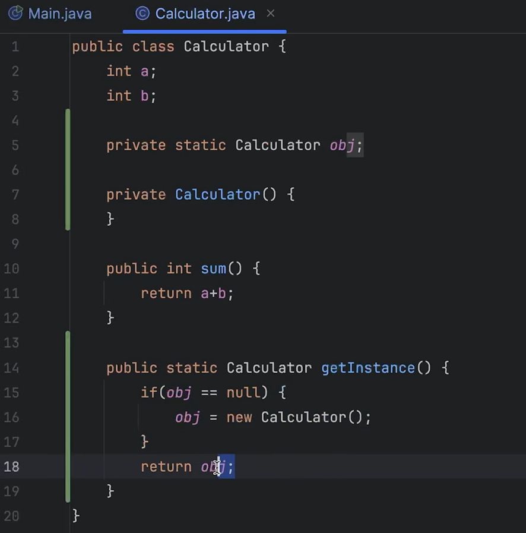
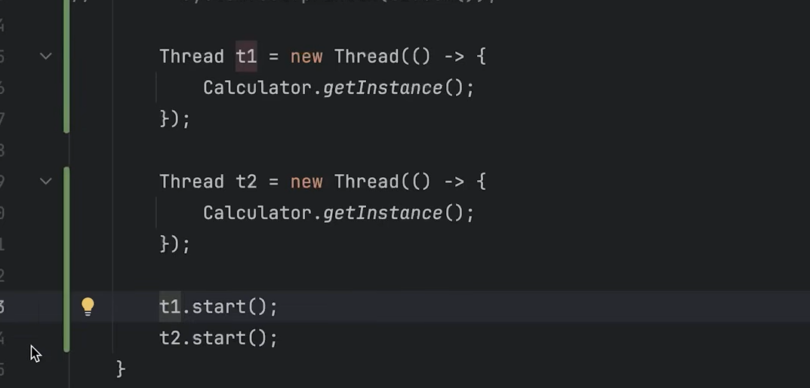
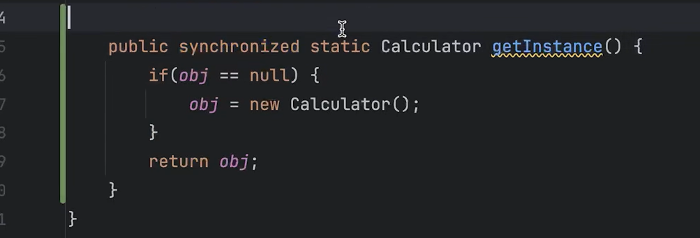
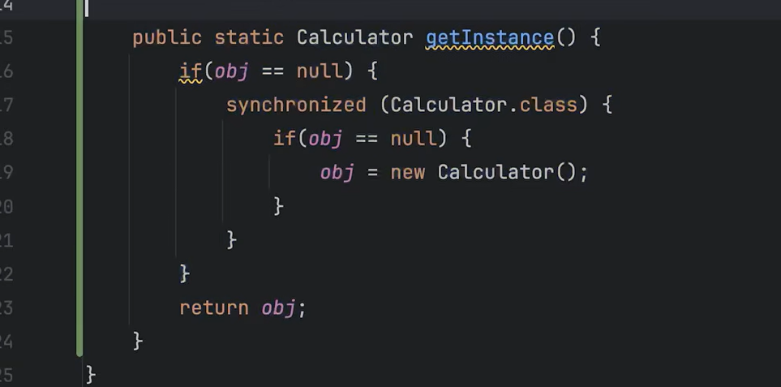

Definition:


How to implement singleton design pattern?
1. Basic(Eager)
2. lazy initialization
3. thread safety using synchronized
4. double checked locking mechanism

**Basic implementation:**

- make constructor private: this stops object creation of the class from outside the scope of that class
- create a new object inside the class as its allowed in private scope.
- create a public static method to return the object to outside world. Static so that the public method can be called 
by the class name without the need of instantiation.



On running the main class the result of both the statements is 10, this is because, only one object is created.

First call updates the sum to 15 but as the object is same at the end sum is set to 10 in the memory by second call to sum



**Lazy Initialization:**

- Drawback of simple singleton impl(Eager): Even if the getInstance() method is not called during initialization an object 
will always be created even tho its not used wasting memory.
- This is because of this line:
```java
private static Calculator obj = new Calculator();
```
- to solve this issue, donot create 
- implement null check, i.e create object ony if call is made and no object is created, if created return the same.


**Multithreaded env**


- with the existing logic for object creation, multiple objects will be created in multithreading scenarios
- to make it thread safe add synchronized keyword to the getInstance() method.



- synchronized draw back: Synchronized is only required once when the object is null, after that the if condition will return false for both the threads and always return the same object
but due to synchronized the threads need to wait unnecessarily.

**Double check locking mechanism:**

- There should not be any lock after the object creation.
- Corrected logic:



- outside if condition ensures that synchronized is invoked only if object is not present.
- inside if condition prevents duplicate object creation during synchronized execution of the block.

- Implementation using enums.

Real world use-cases:
1. Logger
2. Database connection
3. Configuration management


