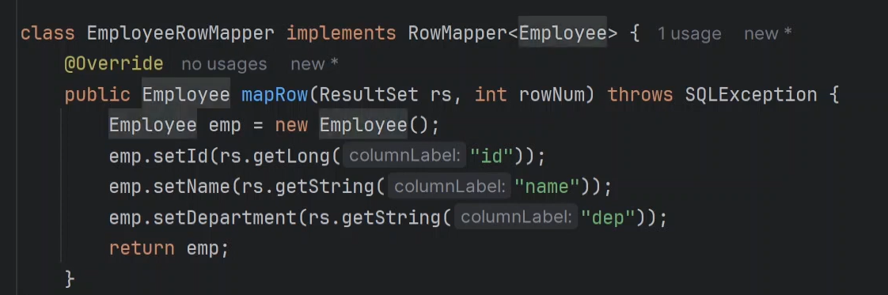
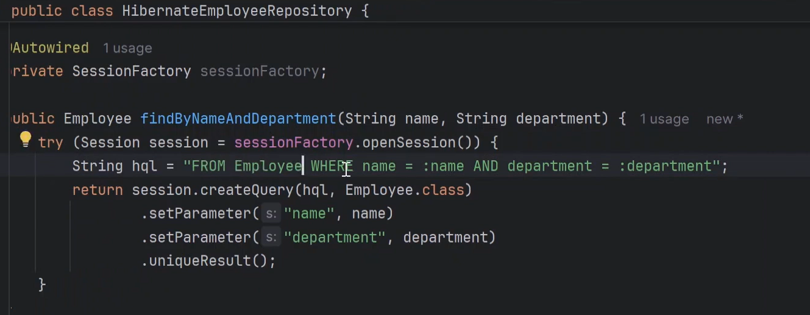
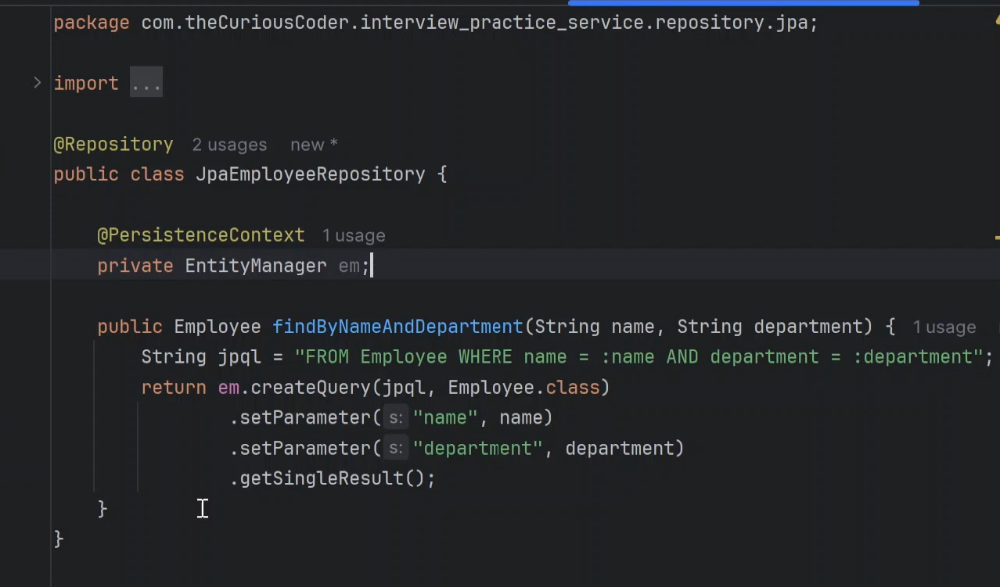
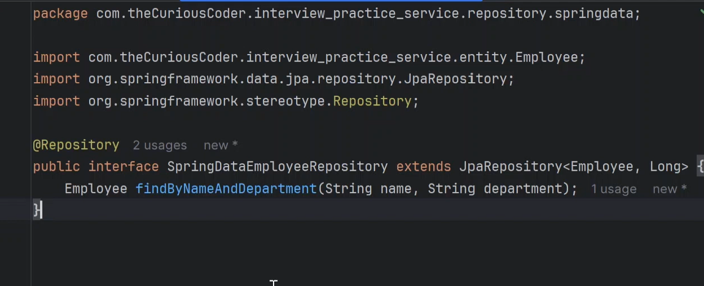

Jdbc -> jdbctemplate need to be autowired
jdbcTemplate.queryForObject(String sql, RowMapper, query arguments)
- needs rowmapper to set values from result set

Hibernate -> SessionFactory
- implementation of JPA
- ORM tool 
- java names of columns in query instead of db names
- No mapping needed
- 

Drawback of hibernate: multiple orm exist with their own implementation query language

JPA: it generalises implementation

- Uses EntityManager to execute query

-JPA and Spring Data JPA are not same
- JPARepository interface is different
- JPA means entity manager interface 
- entity manager methods are Implemented by session 

- Spring Data JPA is an abstraction over JPA
- its a module that lays some specification that all ORM need to follow/provide

- extend JPARepository
- 

