SOLID Principle:

**1. Single Responsibility:**

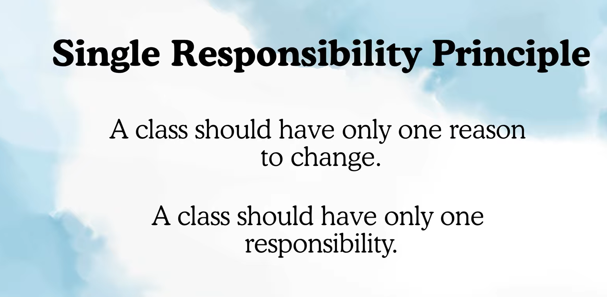

Bad example:

Putting all operations in the OrderService class:

createOrder(), processPayment(), sendEmail(), generateInvoice()

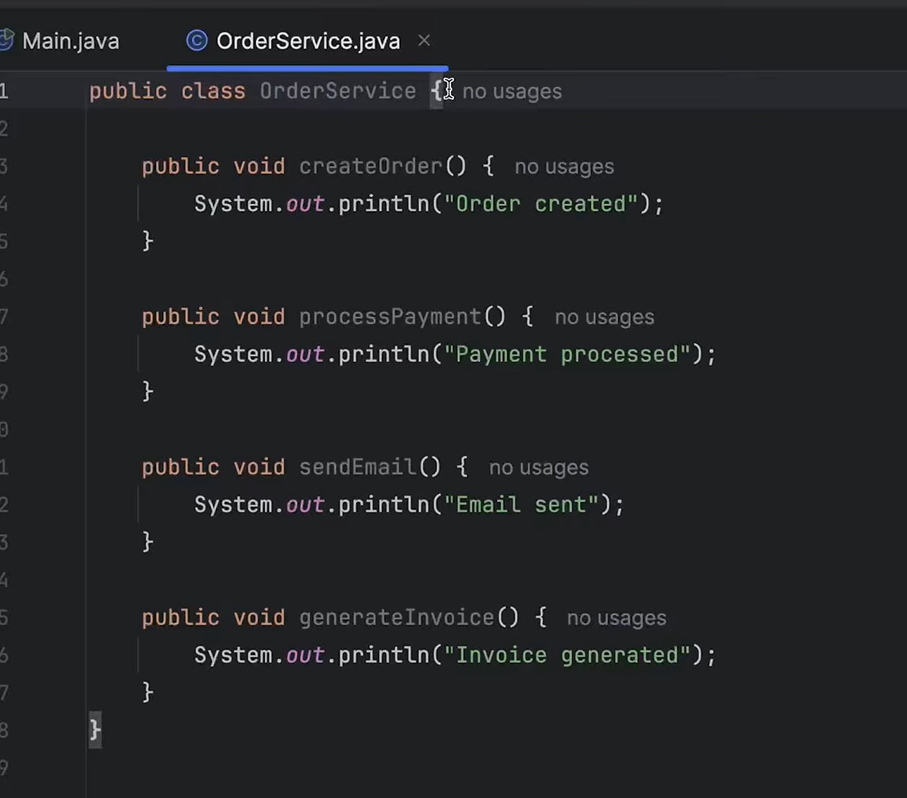

- reduces redability
- creates conflicts between devs
- Unit tests needs to be changed again and again

Solution:
- create separate service classes for each function.
- Every class should have only single reason to change.

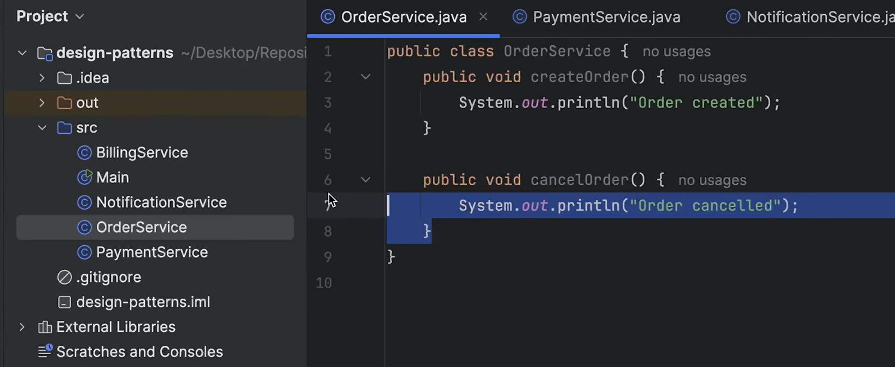

**2. Open Closed Principle:**

Example:

Initially we have a method for processing UPI payments only.

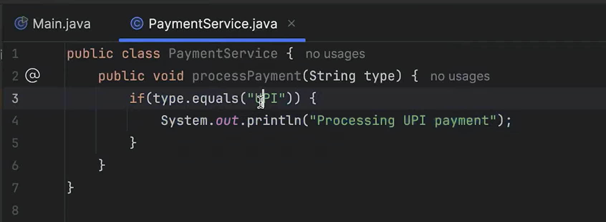

- We want to add more payment methods, we are adding new code to the existing class having UPI functionality already 
tested. This introduces uncertainity as it can break what is working
- we should not change existing class to add new functionality

fix: Keep abstraction

make payment interface and implement different payments methods by extending from the parent class.

**3. Liskov Substitution Principle:**

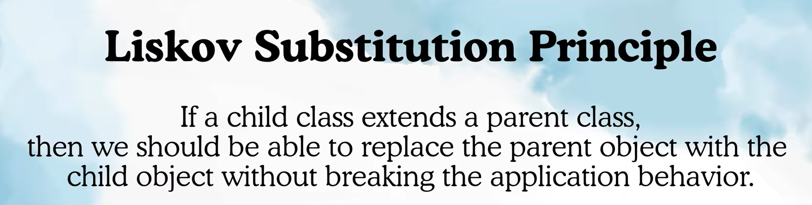

-Child1 and Child2 inherit Parent and have their own methods
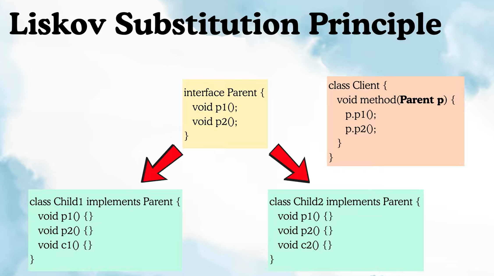

- Now if class client method receives parent as an argument it should work even if we pass child object which is inheritance
behaviour
- So why do we need Liskov principle

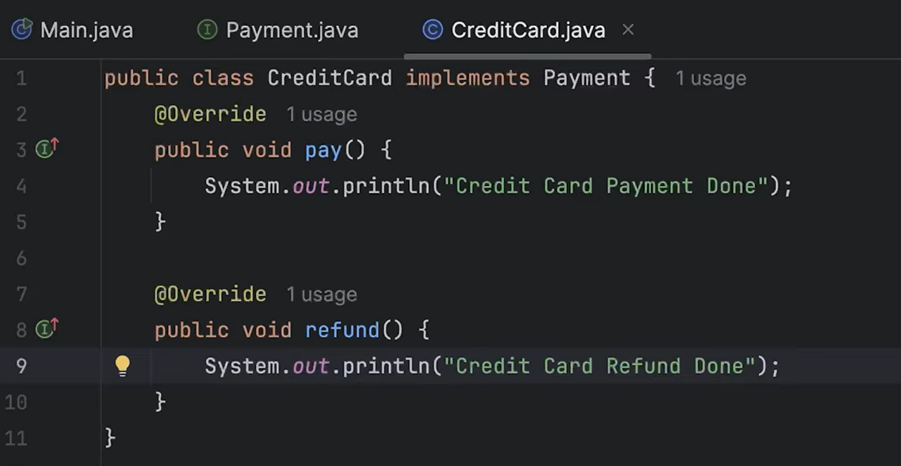

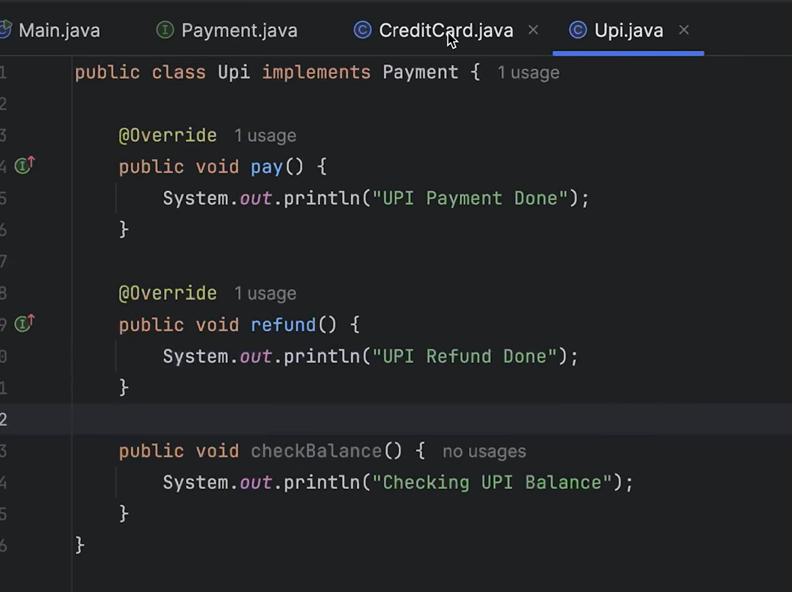

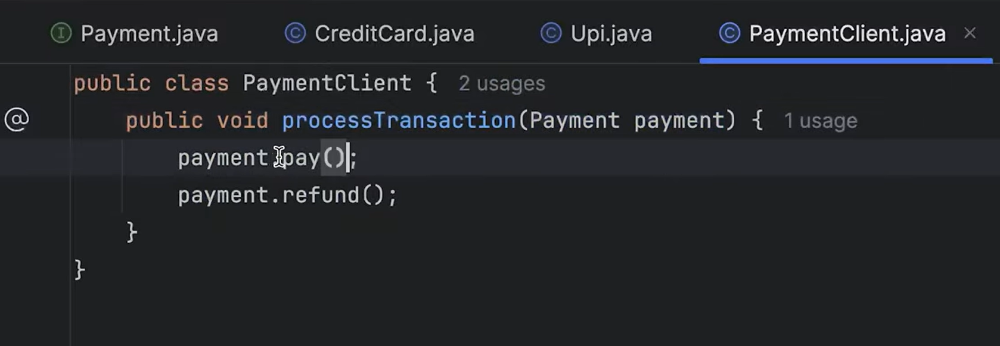

Main:
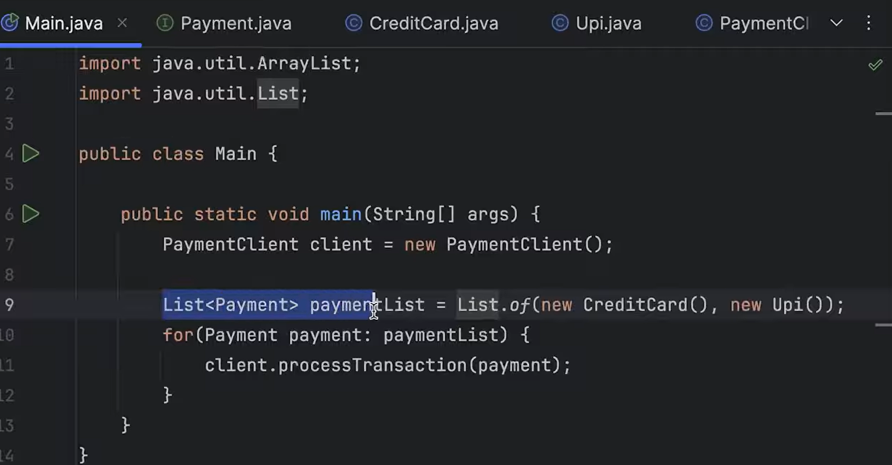

Output: no issue

**scenario**: crypto implements payment interface, but it does not support the refund method

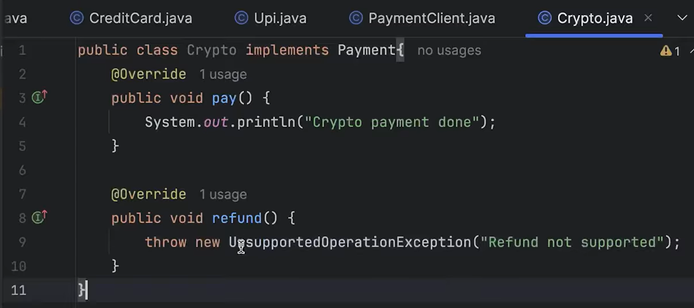

A child class can add a functionality without issue, but when it tries to reduce a functionality given 
in the parent class that caused an issue.

On passing crypto object to client we get error:

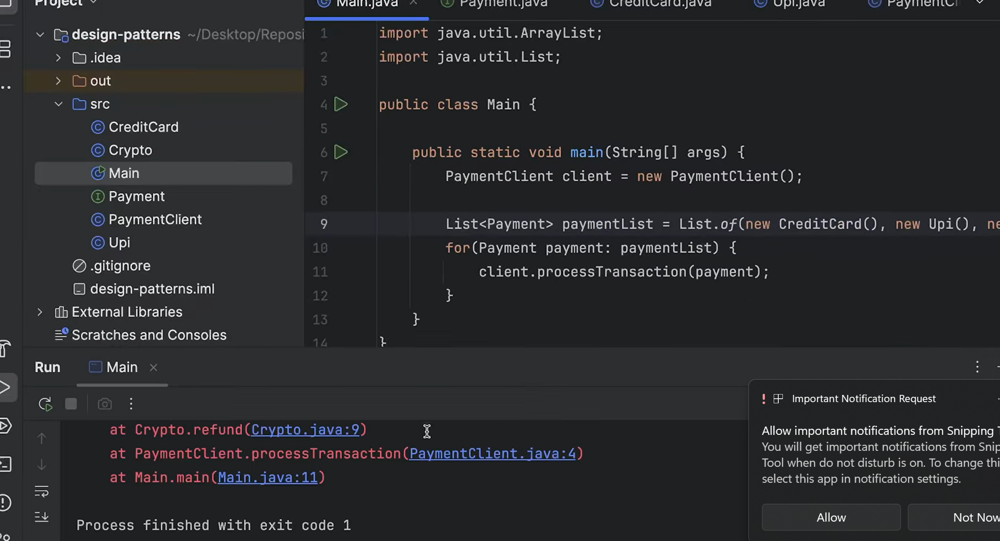

Since client is talking to interface only and it expects all methods to work.
Crypto should never be a child class of payment 

Solution there should be a interface NonrefundablePayments.

Crypto now implements NonrefundablePayments:

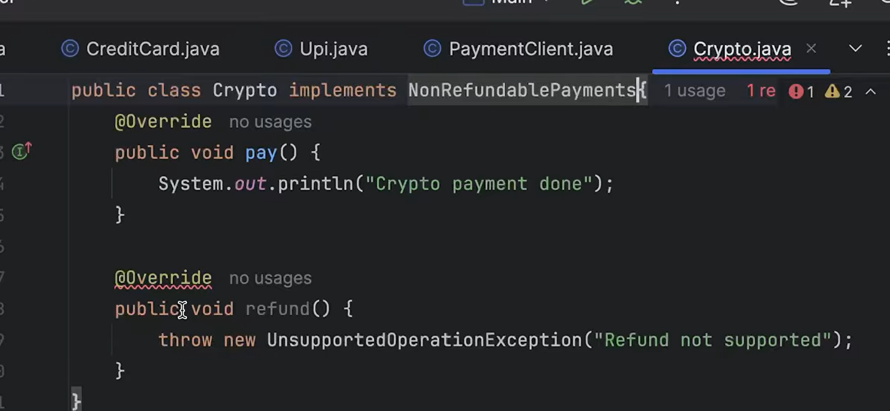

make Payment extend NonrefundablePayments and remove pay method as it will be given in NonrefundablePayments interface.

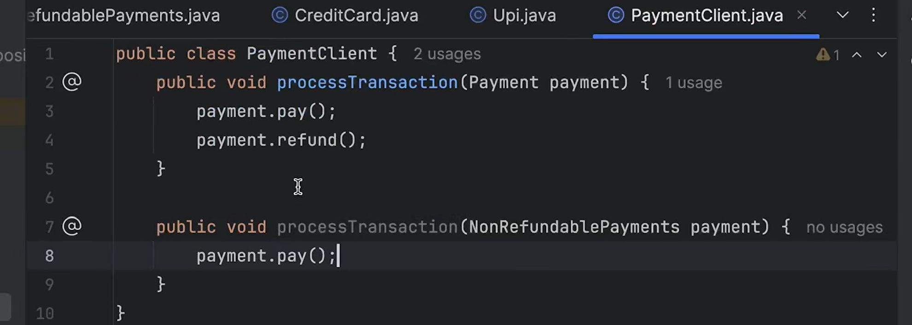

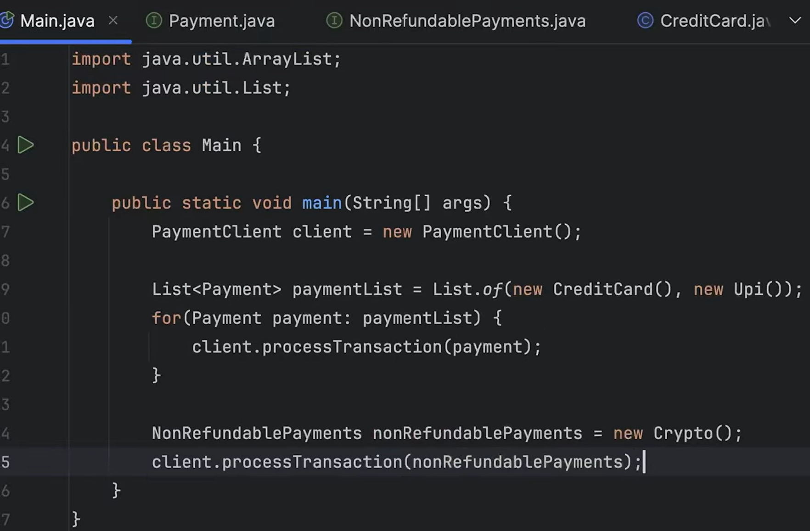

**4. Interface Segregation Principle:**

84

