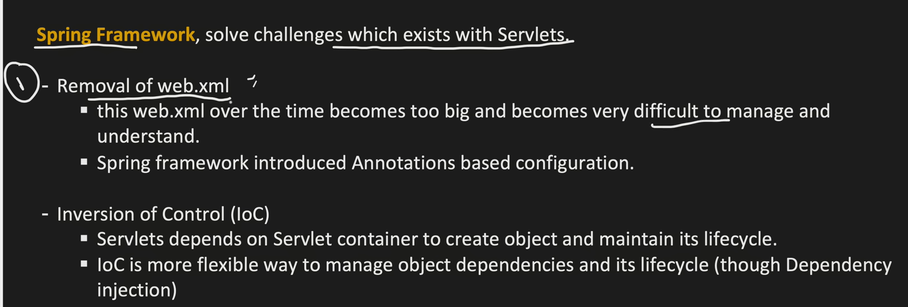
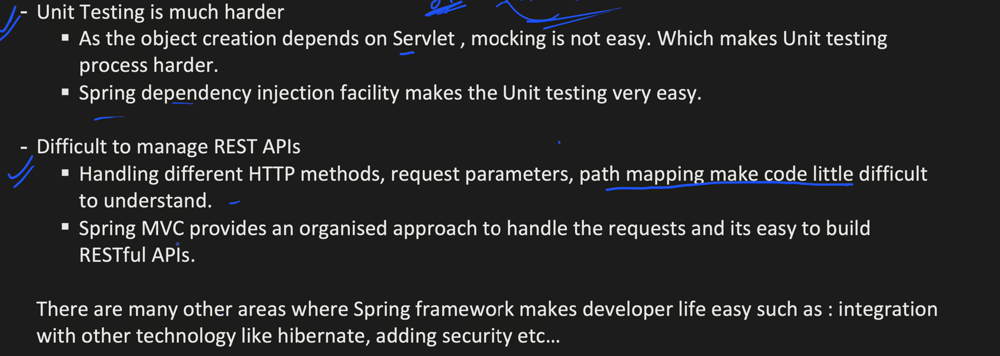
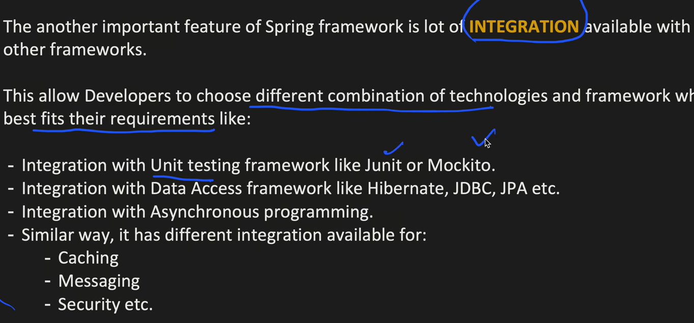
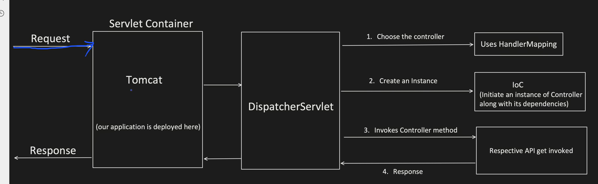
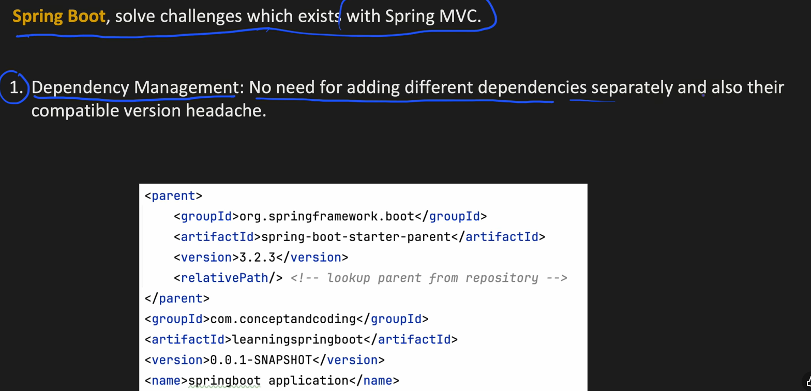
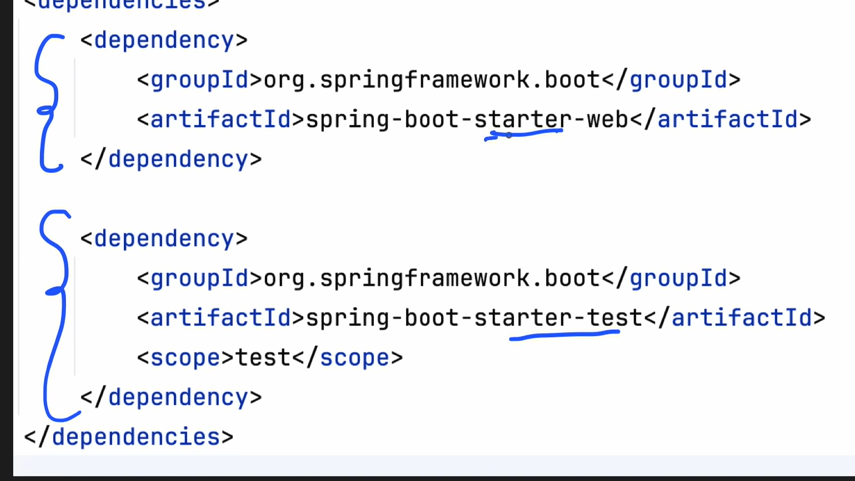
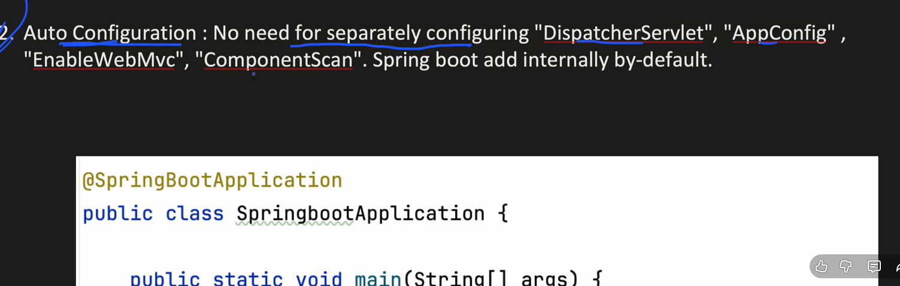
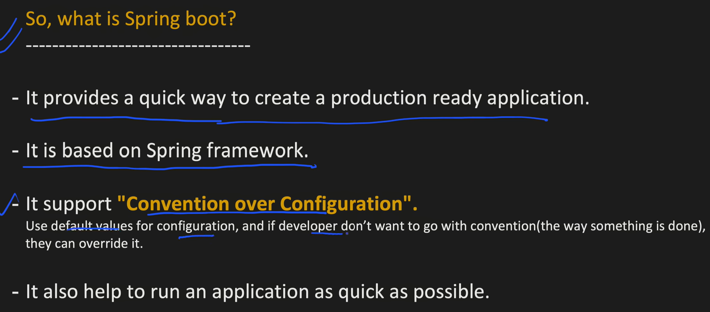

Why SB was introduced: Servlet and Servlet Container

How Servlet used to look:

What springboot solves:

Spring Boot vs Spring MVC:
1. Spring boot handles dependency versions and all dependent versions.

2. 
3. @SpringBootApplication: Combination of @EnableWebMVC, @ComponentScan
4. Embeded Server

5. 
