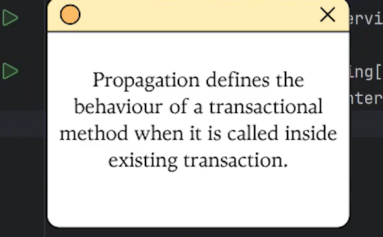
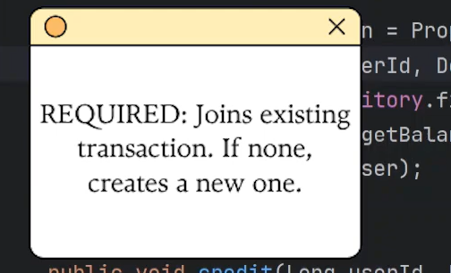
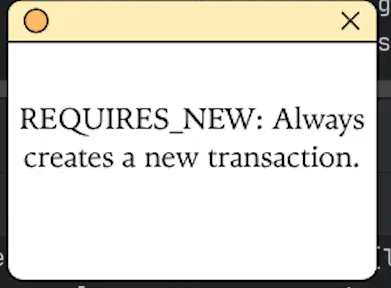
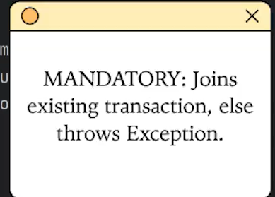
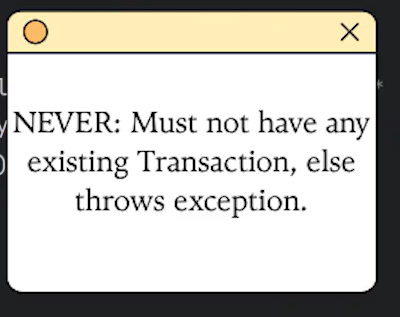
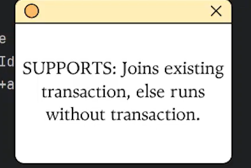
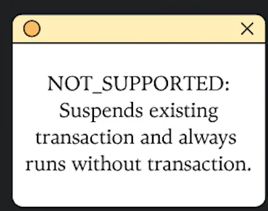
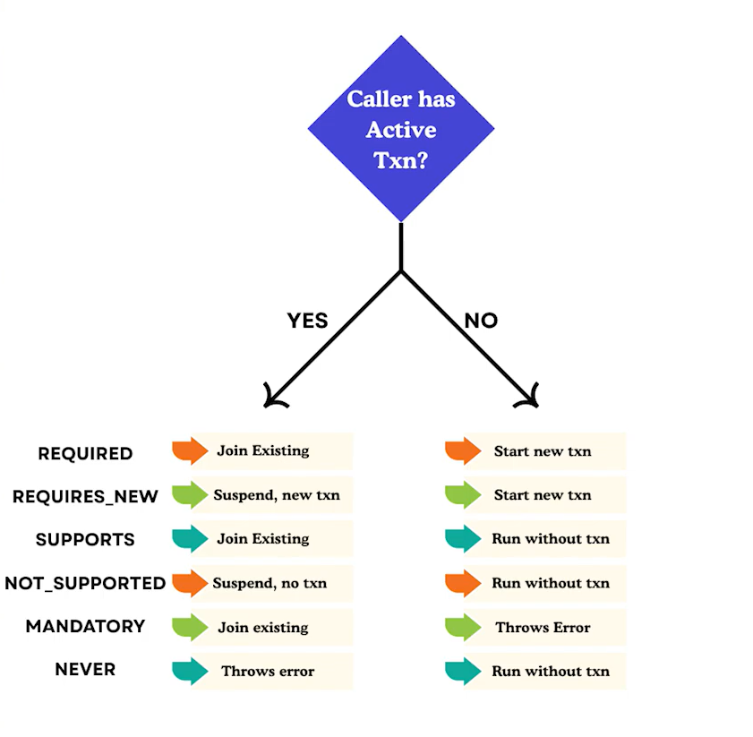

Transactional Propagation

- Required: default propagation - 

-REQUIRES_NEW

-Even if the calling function has @transactional new transaction will be started

Mandatory:

Never 

Supports

not supported

Summary

